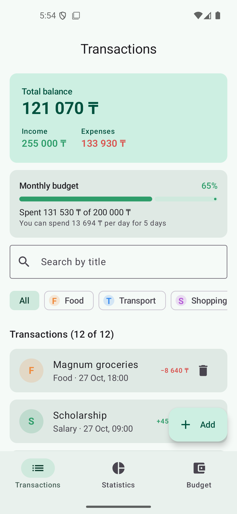
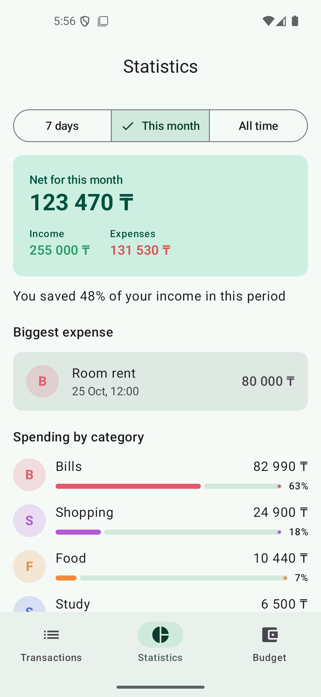
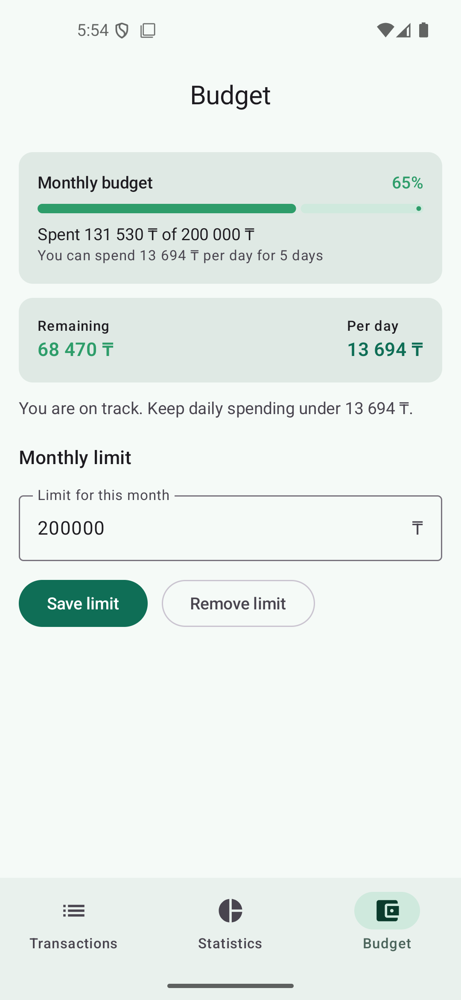
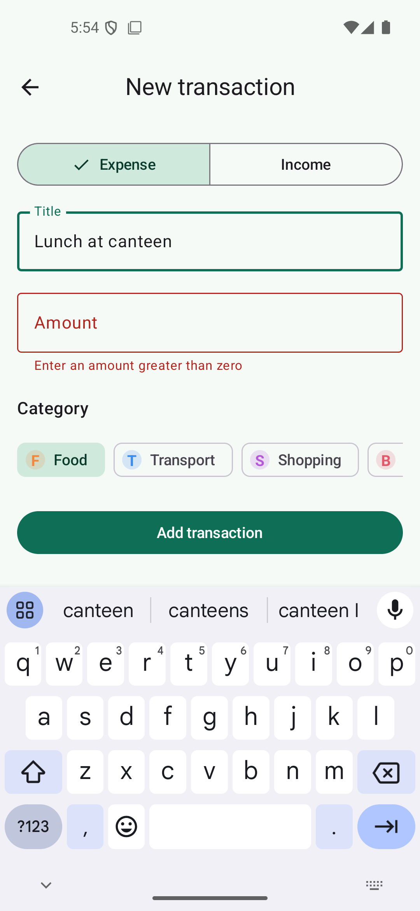
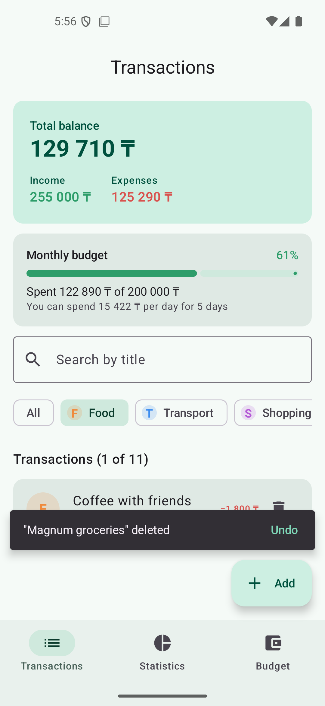

# PocketBudget

PocketBudget is a personal budget tracker for students, built with **Kotlin** and **Jetpack Compose**.
It helps you record income and expenses, see where the money goes, and stay within a monthly
spending limit by showing how much you can still spend per day.

This project continues the single-screen expense tracker from the homework and turns it into a
multi-screen application with navigation, shared state and a clear architecture.

## Features

1. **Transaction tracking**: add, edit and delete income and expense records.
   Deleting shows a snackbar with **Undo**. The form validates the title and amount and shows errors.
2. **Search and filtering**: search transactions by title and filter them by category with chips.
3. **Statistics**: choose a period (7 days / this month / all time) to see income, expenses,
   the share of income saved, the biggest expense and spending by category with progress bars.
4. **Monthly budget**: set a monthly limit and see how much is spent and how much remains,
   plus a daily allowance until the end of the month. The progress bar turns orange
   after 80% and red when the limit is exceeded.

## Screenshots

| Transactions | Statistics | Budget |
|---|---|---|
|  |  |  |

| Add transaction (validation) | Filter + delete with Undo |
|---|---|
|  |  |

## Screens and navigation

Navigation is implemented with **Navigation Compose** (`NavHost` + string routes):

| Route | Screen | How to open it |
|---|---|---|
| `transactions` | List, balance, budget card, search, filters | Start destination / bottom bar |
| `statistics` | Period statistics | Bottom bar |
| `budget` | Monthly limit | Bottom bar or tap the budget card |
| `editor?id={id}` | Add (`id = -1`) or edit a transaction | FAB "Add" or tap a transaction |

Bottom bar navigation uses `popUpTo(startDestination) { saveState = true }`, `launchSingleTop` and
`restoreState`, so switching tabs does not grow the back stack and each tab keeps its scroll position.
The editor receives the transaction id as a `NavType.LongType` argument.

## Architecture

```
app/src/main/java/com/example/pocketbudget/
├── MainActivity.kt                  # sets the theme and PocketBudgetApp()
├── data/
│   ├── Transaction.kt               # data class, enums, sample data
│   └── TransactionRepository.kt     # in-memory source of truth (MutableStateFlow)
├── domain/
│   └── BudgetCalculator.kt          # pure business logic: filter, summary, stats, budget, validation
└── ui/
    ├── BudgetViewModel.kt           # state management (StateFlow), user actions
    ├── Format.kt                    # money / date formatting
    ├── navigation/                  # routes, bottom bar destinations, NavHost + Scaffold
    ├── screens/                     # Transactions, Editor, Statistics, Budget screens
    ├── components/                  # reusable composables (cards, chips, fields, rows)
    └── theme/                       # Material 3 colors and theme
```

- **UI layer** (`ui/screens`, `ui/components`): composables only display state and call callbacks.
  Screens are stateless with respect to app data (state hoisting). They get data and lambdas as parameters.
- **State layer** (`BudgetViewModel`): combines the repository flows with the search query and selected
  category using `combine(...)`, computes the state on `Dispatchers.Default` (`flowOn`), and exposes
  it as `StateFlow<BudgetUiState>` through `stateIn(viewModelScope, WhileSubscribed(5000), ...)`.
- **Logic layer** (`BudgetCalculator`): pure Kotlin functions with no Android dependencies, covered by
  unit tests in `app/src/test`.
- **Data layer** (`TransactionRepository`): keeps data in memory. It can be replaced by Room or a
  network source in the second half of the semester without changing the UI.

### State management

| Tool | Where it is used |
|---|---|
| `ViewModel` + `StateFlow` | `BudgetViewModel.uiState`, `searchQuery` |
| `collectAsStateWithLifecycle()` | `PocketBudgetApp`: collection stops when the app is in the background |
| `rememberSaveable` | Editor form fields and errors, statistics period, budget limit input |
| `remember` | `SnackbarHostState`, derived statistics `remember(transactions, period) { ... }` |
| State hoisting | Screens receive state + callbacks; `CategoryChipRow`, `SegmentedSelector`, `AmountField` are stateless |
| Coroutines | `viewModelScope` / `stateIn`, `flowOn(Dispatchers.Default)`, `rememberCoroutineScope` for snackbars |

### Configuration changes

- The `BudgetViewModel` is scoped to the Activity, so transactions, filters and the budget survive rotation.
- Text typed in the editor and budget forms is kept with `rememberSaveable`.
- The navigation back stack is saved and restored by Navigation Compose.

## Tech stack

- Kotlin 2.2.10, Jetpack Compose (BOM 2026.02.01), Material 3
- Navigation Compose 2.10.2
- Lifecycle ViewModel Compose / Runtime Compose 2.11.0
- Android Gradle Plugin 9.2.1, Gradle 9.4.1, JDK 21
- compileSdk 37, targetSdk 36, minSdk 26
- JUnit 4 for unit tests

No other third-party libraries are used.

## How to run

1. Install **Android Studio** (a version that supports AGP 9.2, with the bundled JDK 21) and the
   **Android SDK Platform 37**.
2. Clone the repository:
   ```bash
   git clone <repository-url>
   ```
3. Open the project folder in Android Studio (**File → Open**) and wait for Gradle sync.
4. Select an emulator or a device with Android 8.0 (API 26) or newer and press **Run ▶**.

From the command line:

```bash
./gradlew assembleDebug          # build the APK: app/build/outputs/apk/debug/app-debug.apk
./gradlew installDebug           # install on a running emulator / connected device
./gradlew testDebugUnitTest      # run unit tests
```

The app starts with sample transactions so every screen has data to show. Data is stored in
memory, so it resets when the app process is killed. Persistence is planned for the second part
of the project.
